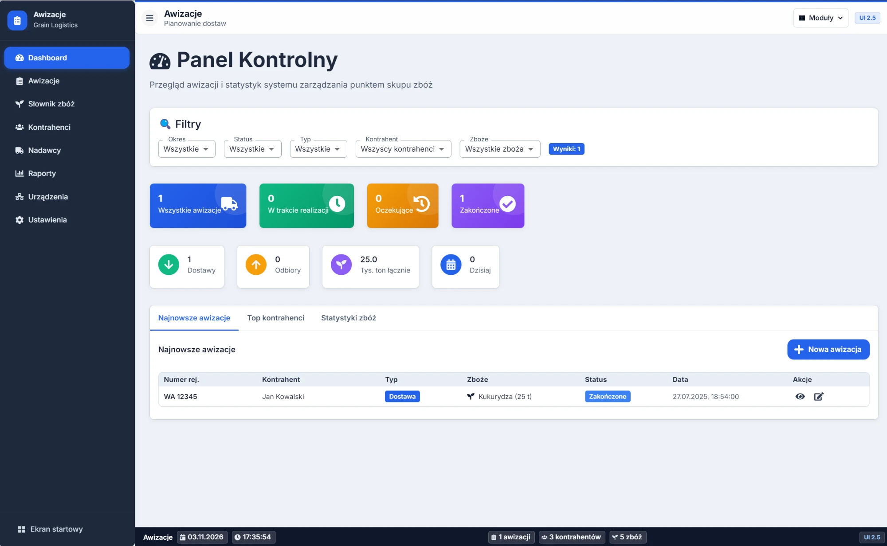
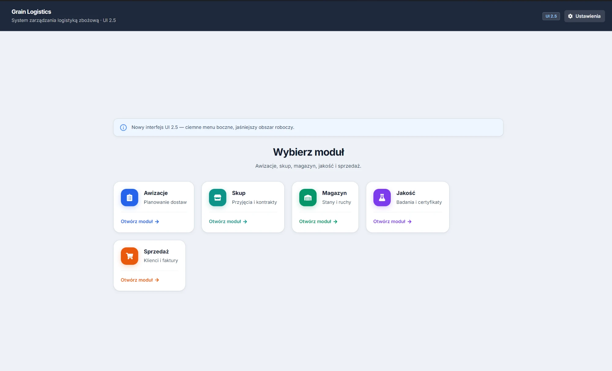

# AwizacjaApp — Grain Logistics

Aplikacja desktopowa do obsługi punktu skupu zbóż: od awizacji dostawy, przez przyjęcie na skupie i magazyn, po kontrolę jakości i sprzedaż. Działa lokalnie na komputerze, bez serwera; dane trzyma w bazie SQLite.





## Moduły

| Moduł | Co obsługuje |
|-------|--------------|
| **Awizacje** | Kalendarz awizacji, kontrahenci, nadawcy, słownik zbóż, raporty |
| **Skup** | Przyjęcia, dostawy, cenniki, kontrakty, dokumenty, reguły jakości |
| **Magazyn** | Magazyny, stany, partie, ruchy, przesunięcia, inwentaryzacja |
| **Jakość** | Badania laboratoryjne, certyfikaty, procesy HACCP/GMP |
| **Sprzedaż** | Klienci, zamówienia, faktury |

Moduły są ze sobą połączone: zapis przyjęcia na skupie mapuje zboże ze słownika skupu na słownik magazynu i tworzy ruch magazynowy w jednej transakcji SQLite.

Każdy moduł ma też panel urządzeń (waga mostowa, drukarka dokumentów). Konfiguracja wagi przez port szeregowy lub TCP jest przygotowana, a w obecnej wersji odczyt wagi jest symulowany.

## Technologie

- Electron (proces główny, komunikacja IPC, dostęp do bazy)
- React 18 + MUI (interfejs)
- SQLite przez sql.js, schemat w `schema.sql`
- jsPDF + html2canvas (eksport dokumentów do PDF)

## Uruchomienie

Wymagania: Node.js 16+ i npm.

```bash
npm install
npm start          # build React + uruchomienie Electron
npm run dev        # tryb deweloperski z hot-reload
```

Na Windows można też uruchomić `start.bat`.

### Instalator

```bash
npm run dist
```

Gotowe pliki trafiają do folderu `dist/`.

## Dane

- Baza: `%APPDATA%/grain-logistics-app/grain_logistics.db` (Windows)
- Kopia zapasowa, przywracanie i eksport do JSON: **Ustawienia** na ekranie startowym

## Struktura

```
electron/          – proces główny, IPC, SQLite
  dbConstants.js   – lista dozwolonych tabel
  dbHelpers.js     – migracje, transakcje, mapowanie słowników
src/modules/       – moduły UI (awizacje, skup, magazyn, jakość, sprzedaż)
schema.sql         – pełny schemat bazy
```

## Testy

```bash
npm run test:db
```

---

Więcej o projekcie: [portfolio](https://portfolio-jakubstachowskii.vercel.app/projekty/awizacja-app/)
